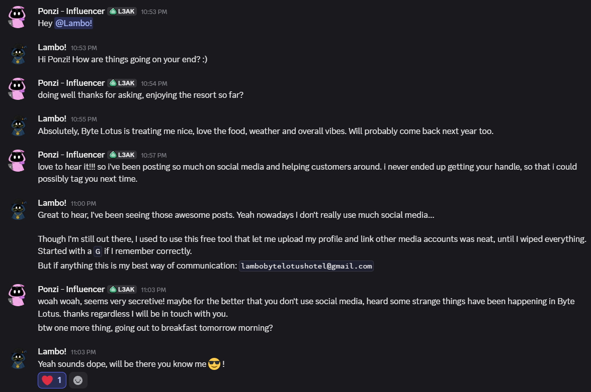
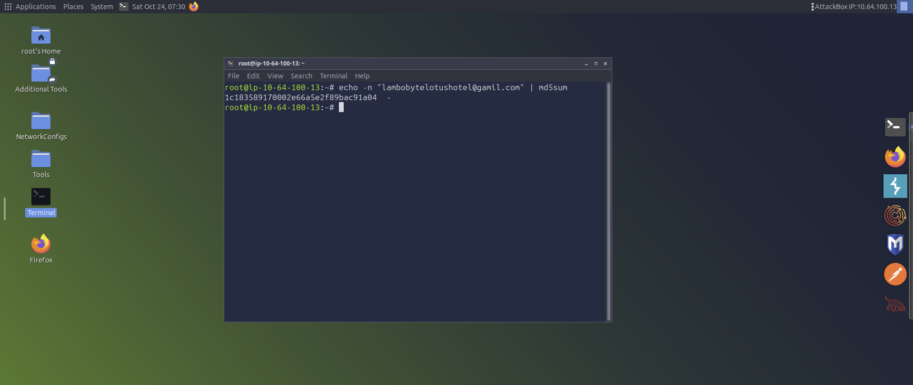
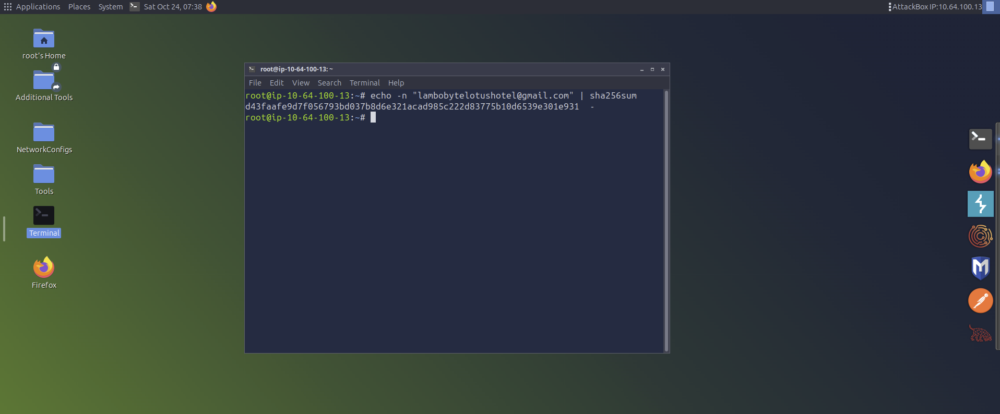
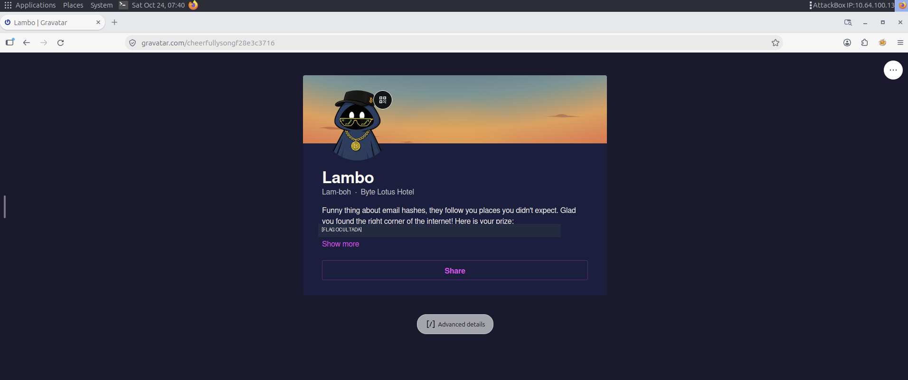
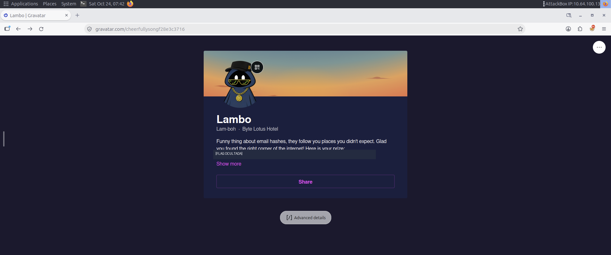
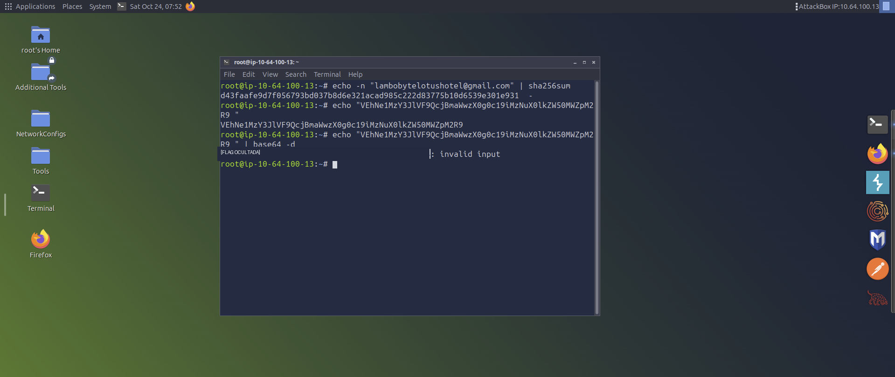

# 🕵️ Overheard at Breakfast — TryHackMe | OSINT

  

**Laboratório:** [Overheard at Breakfast](https://tryhackme.com/room/hh-overheardatbreakfast-6f01793c)  
**Categoria:** OSINT • **Dificuldade:** Easy • **Data:** 24/10/2026

> **Nota:** este write-up documenta o processo de aprendizagem. A flag foi ocultada nos prints e não é publicada aqui.

## 1. Objetivo

Investigar pistas presentes em uma conversa fictícia entre Ponzi e Lambo, identificar uma possível presença digital pública e analisar as informações encontradas.

## 2. Reconhecimento inicial

O arquivo `conversation.png` apresenta uma conversa na qual Lambo menciona uma ferramenta de perfis iniciada com a letra **G** e compartilha um e-mail. Esses dados serviram como ponto de partida para uma hipótese sobre o **Gravatar**.



**Hipótese:** um perfil público poderia estar associado ao e-mail citado na conversa. Isso ainda precisava ser verificado.

## 3. Gerando hashes do e-mail

Na AttackBox, comecei gerando um hash **MD5** a partir do e-mail encontrado:

```bash
echo -n "lambobytelotushotel@gmail.com" | md5sum
```



Depois gerei um hash **SHA-256**:

```bash
echo -n "lambobytelotushotel@gmail.com" | sha256sum
```



**Por que SHA-256?** A consulta com o hash MD5 não funcionou: o Gravatar deixou de aceitar MD5 como identificador do e-mail e passou a usar SHA-256. Por isso a busca do perfil foi feita com o hash SHA-256.

O argumento `-n` evita a quebra de linha adicionada por padrão pelo `echo`; essa diferença altera o hash. **Hash não é criptografia reversível**: aqui ele foi utilizado como identificador para consulta.

> **Nota de conferência:** os hashes capturados nos prints podem não corresponder exatamente ao endereço acima. Antes de reutilizar um resultado, compare a entrada digitada com o e-mail da imagem original. Para referência, o MD5 do e-mail digitado acima é `d4a5fc5d3128890778667e24617d7cc0` e o SHA-256 é `d43faafe9d7f056793bd037b8d6e321acad985c222d83775b10d6539e301e931`.

## 4. Correlação com perfil público

Ao consultar o Gravatar, encontrei um perfil chamado **Lambo**, com referência ao **Byte Lotus Hotel**. A coincidência de nome e contexto fortaleceu a hipótese de vínculo com a conversa, dentro do cenário fictício da room.



A descrição do perfil continha uma sequência aparentemente codificada.



## 5. Investigação da codificação Base64

Os caracteres presentes na sequência sugeriram **Base64**. Essa codificação não é criptografia: ela transforma dados em uma representação textual que pode ser decodificada sem chave.

Na AttackBox, experimentei:

```bash
echo -n "SEQUENCIA_BASE64" | base64 -d
```



Uma das tentativas exibiu o aviso `base64: invalid input`. Isso pode ocorrer por caracteres extras, sequência incorreta ou dados que não estejam no formato esperado. O registro desse erro faz parte do processo investigativo e da validação da evidência.

## 6. Metodologia aplicada

1. **Observação:** extração de pistas de uma conversa.
2. **Hipótese:** possível associação entre o e-mail e uma plataforma de perfil.
3. **Teste:** geração de hashes e consulta a uma fonte pública.
4. **Correlação:** comparação do perfil encontrado com o contexto da room.
5. **Análise:** identificação de um possível texto codificado e teste de decodificação.

## 7. Aprendizados

- Fundamentos de **OSINT** e correlação de identidades públicas.
- Diferença entre **hashing** (MD5/SHA-256) e **codificação** (Base64).
- Encadeamento de comandos no Linux com `|`.
- Importância de registrar erros, validar entradas e preservar evidências.

## 8. Conclusão

O laboratório mostrou como pequenos indícios públicos podem ser relacionados para construir e verificar hipóteses investigativas. A principal lição foi **não confundir uma pista com uma conclusão confirmada**.

---

**Uso educacional.** Investigação realizada no contexto autorizado do laboratório TryHackMe. A flag e qualquer solução pronta foram omitidas das evidências públicas.
